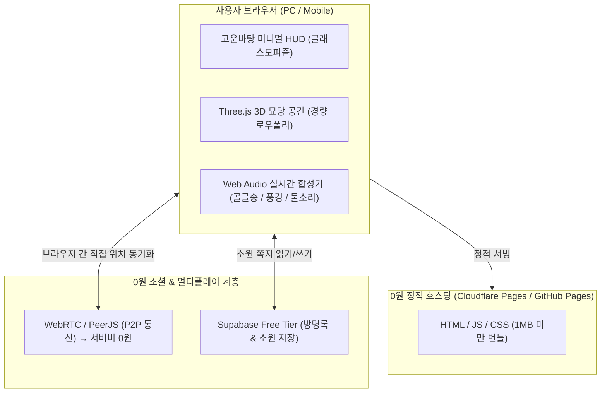

# 《묘당 (猫堂 · CatDang)》 힐링 메타버스 구현 계획서

## [Goal Description]
최근 '산사(山寺)', '청계천 힐링', '세월낚시터', '무교당', '길냥이 책방' 등 웹 브라우저에서 가볍게 접속해 일하거나 공부하며 곁에 켜두는 **'산사라이크(Sansa-like)' 앰비언트 메타버스**가 큰 호응을 얻고 있습니다.

본 프로젝트의 목표는 **"귀엽고, 동화 같으며, 절제된 고양이 중심의 가상 공간인 《묘당(猫堂 · CatDang)》"**을 구축하는 것입니다.
특히 **"100% 영구 무료(0원 인프라)"** 원칙을 고수하여, 사용자 접속이 폭증하더라도 서버 유지비 부담 없이 지속 가능한 웹 서비스를 완성합니다.

---

## 1. 레퍼런스 분석 및 도출된 핵심 문법 ('산사라이크')

| 레퍼런스 | 핵심 특징 및 벤치마킹 요소 |
| :--- | :--- |
| **청계천 힐링** (`cheonggye-healing.vercel.app`) | Three.js 경량 3D 지형, Web Audio 실시간 합성 사운드, '걸어서 시작' vs '멍때리기로 시작'의 2트랙 UX |
| **세월낚시터** (`studio-meot.github.io/sewol/`) | 고운바탕 폰트, 한지·먹·인주 팔레트, 삿갓 낚시꾼과 동물들의 정적인 여백의 미, GitHub Pages 기반 100% 무료 배포 |
| **무교당** (`mugyo.zacra007.workers.dev`) | 별하늘 아래 '멍마당', 걷기·앉기·눕기·손흔들기 액션, Cloudflare Workers 기반의 초경량 통신 |
| **길냥이 책방** (`stray-cat-books.pages.dev`) | "고양이가 되어 함께 걷는 3D 서점", 귀여운 고양이 아바타와 냥냥 모션, 책 둘러보기 |

### 도출된 《묘당》의 차별화 포인트
1. **내가 고양이가 되는 공간**: 치즈냥, 삼색냥, 턱시도, 깜냥이 중 선택해 사뿐사뿐 경내 산책
2. **동사(Action)의 힐링화**: 걷기, 툇마루에서 **식빵 굽기(골골송 증폭)**, **야옹(울림)**, **기지개**
3. **귀여운 사찰 인터랙션**: **츄르 공양하기**, **소원 나무(방명록)**, **고양이 발도장 부적(냥점)**
4. **사운드스케이프**: Web Audio 실시간 오실레이터로 합성하는 **골골송(Purr)** + 영롱한 **묘당 풍경소리** + 빗소리/바람소리

---

## 2. 100% 영구 무료(0원) 시스템 아키텍처



- **호스팅 비용**: **0원** (Cloudflare Pages 무제한 대역폭 또는 GitHub Pages)
- **사운드 스트리밍 비용**: **0원** (Web Audio API를 이용해 클라이언트 브라우저에서 직접 파형 합성)
- **3D 에셋 비용**: **0원** (Three.js 내장 지오메트리 및 경량 최적화 절차적 생성 기법 적용)
- **실시간 통신 비용**: **0원** (P2P WebRTC로 유저 브라우저끼리 직접 좌표 교환, 또는 Cloudflare Workers 무료 일 10만 건 티어)

---

## User Review Required

> [!IMPORTANT]
> **첫 번째 프로토타입 범위 확인**
> 1. 기술 스택: **Vite + Three.js + Web Audio API + Vanilla CSS (한지/먹빛 미학)**
> 2. Phase 1 (MVP) 범위:
>    - 3D 묘당 공간 (한옥 툇마루, 기와 처마, 처마 끝 고양이 풍경, 졸졸 흐르는 작은 돌샘, 숲속 안개)
>    - 고양이 캐릭터 조작 (WASD / 마우스 / 모바일 가상 패드)
>    - 4가지 기본 액션: `사뿐 걷기`, `식빵 굽기(골골송 진동)`, `야옹(울림과 하트)`, `기지개`
>    - 2가지 모드: `사뿐 산책 모드` vs `카메라 자동 순회 멍때리기(Zen) 모드`
>    - Web Audio 사운드 믹서: `골골송 볼륨`, `바람소리 볼륨`, `풍경 벨 볼륨`
> 3. Phase 2 (확장): 츄르 공양대, 소원 쪽지 매달기, 오늘의 냥점 부적 카드 공유

---

## Open Questions

> [!NOTE]
> 1. **시작 화면 닉네임**: 무교당처럼 입장 시 "마당에서 부를 이름(예: 삼색이 집사)"을 묻는 방식을 선호하시나요, 아니면 청계천처럼 아무 입력 없이 '산책' / '멍때리기' 버튼만으로 즉시 진입하는 것을 선호하시나요? (추천: 심플한 즉시 진입 후 원할 때 닉네임 설정)
> 2. **초기 기본 카메라 시점**: 고양이의 뒤를 따르는 3인칭 쿼터뷰(아이소메트릭 느낌)가 가장 귀여운데, 이 시점을 기본으로 설정할까요?

---

## Proposed Changes

### 프로젝트 기본 환경 구축
#### [NEW] `package.json`
- `vite`, `three`, `@types/three` 등 필수 경량 의존성 구성

#### [NEW] `index.html`
- 고운바탕(`Gowun Batang`) 웹폰트 로드
- 메타태그(SEO / OpenGraph), 풀스크린 캔버스 및 미니멀 HUD 레이아웃

#### [NEW] `style.css`
- 한지(#f5f0e6), 먹(#1c1b18), 주홍 인주(#d9583b) 기반의 한국적 서정성 테마
- 글래스모피즘 필 버튼, 반응형 하단 액션 독(Dock), 멍때리기 모드 전환 연출

#### [NEW] `src/audio.js`
- Web Audio API 기반 오디오 엔진:
  - 저주파 삼각파/노이즈 필터를 조합한 고양이 골골송(Purr) 발생기
  - 벨 필터(FM/Add synthesis) 기반의 맑고 긴 여운을 남기는 풍경(鈴) 소리
  - 자연스러운 앰비언트(바람소리, 물소리)

#### [NEW] `src/world.js`
- Three.js 씬 구축:
  - 부드러운 안개(Fog), 따뜻한 햇살(DirectionalLight + Soft Shadow)
  - 목조 툇마루, 기와지붕, 작은 연못, 돌탑, 소원 나무

#### [NEW] `src/cat.js`
- 절차적/로우폴리 고양이 메시 및 애니메이션 컨트롤러:
  - 몸통, 귀, 꼬리, 다리 관절 구조
  - 걷기, 달리기, 멈춤, 식빵 굽기(웅크림), 기지개, 야옹 모션

#### [NEW] `src/main.js`
- 앱 초기화, 모드 전환(산책 ↔ 멍때리기), 입력 이벤트 바인딩 및 루프 구동

### 7대 테마 공간 (World System) 아키텍처
기존 단일 공원에서 취향과 기분에 따라 순간이동할 수 있는 7개의 독립 테마 월드 구축:
1. **🌳 평화 공원 (`ParkWorld`)**: 오리지널 2.5D 아이소메트릭 디오라마, 아치 다리, 연못, 츄르 매점, 벚꽃
2. **👾 레트로 도트 마을 (`PixelWorld`)**: 8-bit 픽셀 타일, 블록 지붕 집, 픽셀 꽃밭, 징검다리
3. **🧱 마인크래프트 세계 (`VoxelWorld`)**: 복셀 잔디 블록, 통나무 통나무집, 복셀 횃불, 계단식 언덕
4. **♨️ 달빛 고양이 온천 (`OnsenWorld`)**: 따뜻한 수증기 파티클 노천탕, 붉은 도리이, 대나무 숲, 디딤돌
5. **🌌 별빛 우주 천문대 (`CosmicWorld`)**: 보랏빛 성운과 별가루, 거대 달 표면, 돔 천문대, 떠다니는 행성
6. **🪵 포근 다락방 찻집 (`AtticWorld`)**: 따스한 원목 마루, 벽난로의 장작불, 찻상, 털실 뭉치
7. **🌅 해질녘 노을 해변 (`BeachWorld`)**: 붉은 석양 바다, 백사장, 비치 파라솔, 야자수와 서프보드

- **동적 충돌체 & 높이맵 연동**: `physics.setWorld(world)`를 통해 월드별 수역, 장애물, 높낮이를 동적으로 스위칭
- **멀티플레이 & NPC 리스폰**: `network.setWorld(world)`로 자율 산책 냥이 5마리가 각 월드의 핵심 명당을 누빔
- **부드러운 암전 페이드**: 공간 이동 시 0.32초의 부드러운 검정 암전 트랜지션 제공

---

## Verification Plan

### Automated Tests
```bash
npm run build
```
- 번들 사이즈가 1MB 미만으로 정상 빌드되는지 확인

### Manual Verification
1. **로컬 실행**: `npm run dev` 실행 후 브라우저(PC 및 모바일 뷰포트)에서 접속
2. **시각적 품질 확인**: 따뜻한 한옥 툇마루와 부드러운 빛내림, 고양이의 자연스러운 움직임 확인
3. **사운드스케이프 확인**: 소리 켜기 버튼 클릭 시 맑은 풍경 소리와 편안한 골골송(식빵 굽기 시 증폭) 재생 확인
4. **멍때리기 모드**: '멍때리기' 클릭 시 UI가 최소화되고 카메라가 사당을 평화롭게 비추는지 확인
